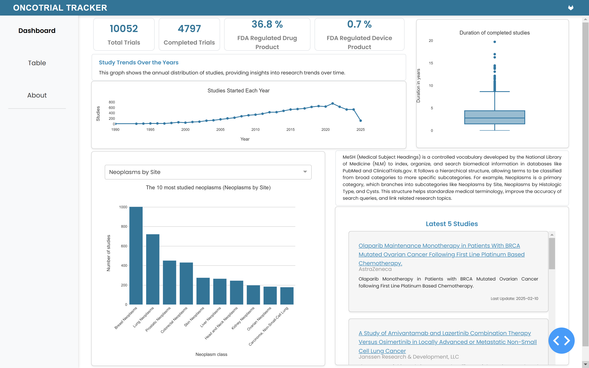
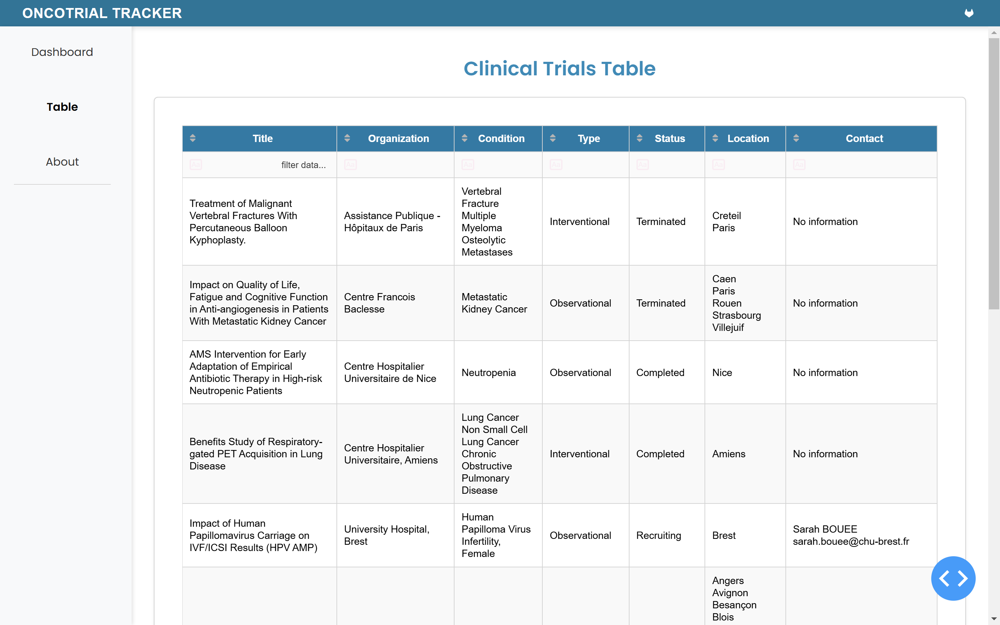

# Dashboard OncoTrial Tracker

## Lien d'accès à l'application 🔗
Notre application OncoTrial Tracker est disponible depuis ce lien : https://oncotrial-tracker.onrender.com

## Description du projet 🔍

L'application OncoTrial Tracker a été développée dans le cadre du cours de web scraping, avec pour objectif de faciliter l'analyse et l'exploration des essais cliniques répertoriés dans la base de données de ClinicalTrials.gov. Les essais concernent les cancers recensés en France.

**Objectifs du projet**

Cette application vise à :

- Centraliser et visualiser les données sur les essais cliniques en France,
- Proposer un outil interactif permettant d’explorer les études selon les organes, types d'interventions ou encore le statut des essais,
- Fournir des analyses graphiques afin d’améliorer la compréhension des essais cliniques,
- Aider les professionnels de santé et chercheurs à identifier des opportunités et à suivre les tendances et dernières avancées dans le domaine.

**Sources des données**

Les données exploitées dans ce projet proviennent directement de l'API publique de ClinicalTrials.gov. À travers des scripts de web scraping, les données ont été collectées, nettoyées et intégrées dans une base de données. L'application permet ensuite de présenter ces informations de manière intuitive et interactive grâce à une interface construite avec Dash (langage python) et CSS.

**Comment ça fonctionne ?**

Les essais cliniques sont extraits et organisés dans plusieurs catégories. Ces données sont traitées pour fournir une visualisation claire, avec des options de tri et de recherche.
Le projet utilise des techniques de manipulation de données et des outils de visualisation interactifs pour répondre aux besoins des utilisateurs finaux.

**À qui s'adresse ce projet ?**

Cette application a été pensée pour :
- Les professionnels de santé souhaitant avoir une vue d’ensemble des essais cliniques en France,
- Les chercheurs travaillant sur le développement de nouvelles thérapies,
- Les institutions impliquées dans le suivi des essais cliniques.

## Screenshots 📸






## Installation 📀 

Si vous souhaitez utiliser le dashboard OncoTrial Tracker sur votre serveur local, il faut cloner ce dépôt GitLab et installez les dépendances nécessaires. 

 ⚠️ **Prérequis**
Avant de lancer l’application en local, assurez-vous d’avoir installé les éléments suivants :

- Python 3.7 ou supérieur
- pip : Le gestionnaire de paquets Python
- Les dépendances listées dans requirements.txt


## Structure du répertoire 📂
Voici la structure principale du projet :
```bash
oncotrial_tracker/
├── assets/              # Fichiers statiques (images, styles CSS, etc.)
│   ├── styles.css       # Feuille de style CSS pour le tableau de bord
│   └── logo-gitlab.png  # Logo GitLab utilisé dans l'application
├── data/                # Données brutes issues du webscraping
│   ├── trials.csv       # Données des essais cliniques
│   ├── mesh.csv         # Données MeSH (Medical Subject Headings)
│   └── loc.csv          # Données des localisations géographiques des essais
├── dataframe.py         # Script pour la manipulation des données
├── desc2024.zip         # Dossier MESH 
│   └── desc2024.xml     # Descripteurs MeSH (Medical Subject Headings) pour l'année 2024
├── fonctions.py         # Fonctions utilitaires pour les analyses statistiques
├── oncotrials.py        # Script principal pour exécuter le tableau de bord
├── README.md            # Documentation du projet
├── requirements.txt     # Liste des dépendances nécessaires
└── LICENSE              # Licence du projet
```

## Contact ℹ️

Pour plus d'informations, contactez nous par mail : 

- ABDAOUI Hâjar : hajar.abdaoui.etu@univ-lille.fr
- AZNAY Nassima : aznay.nassima.etu@univ-lille.fr
- BENGUENNA Célia : benguenna.celia.etu@univ-lille.fr
- MOUS Manal : mous.manal.etu@univ-lille.fr
- TAIBI Chaima : chaima.taibi.etu@univ-lille.fr

## Licence 
Ce projet est sous licence MIT. Consultez le fichier LICENSE pour plus d'informations.
